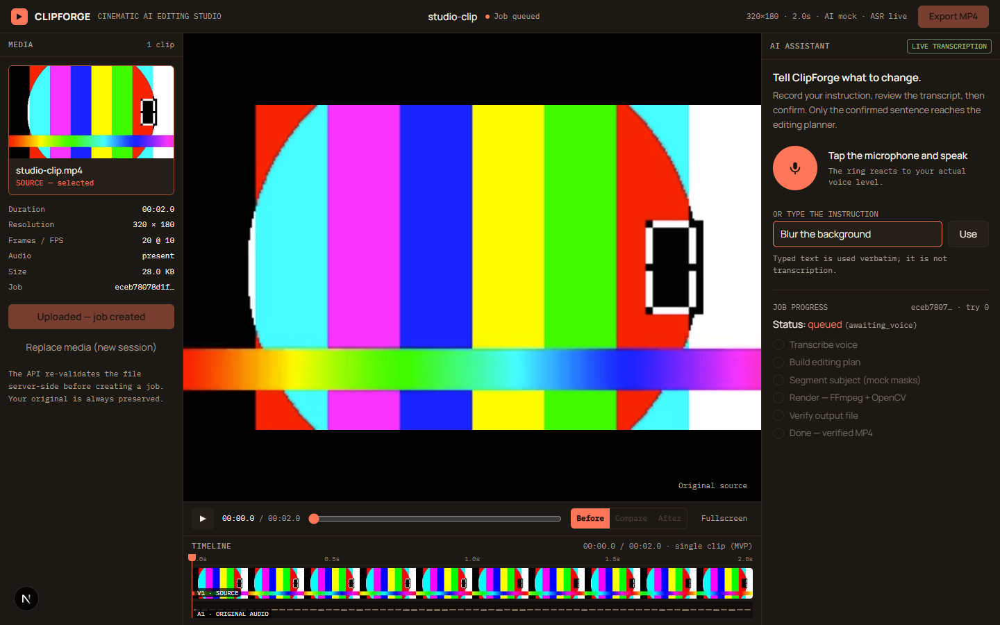

# ClipForge

**Voice-first AI video editing studio — speak the edit, get a real MP4.**

Built for the **Meta Global Hackathon**. ClipForge is not a UI mockup: rendering is real
FFmpeg + OpenCV, outputs are verified with ffprobe, and live runs use Meta Muse models for
transcription and editing direction.



---

## Why ClipForge

Video editing is powerful but slow to learn. Creators know what they want — “blur the
background and keep me sharp” — but translating that into tracks, masks, keyframes and
export settings is the hard part.

ClipForge turns a spoken instruction into a validated editing plan and a real rendered file:

1. Upload a short clip.
2. Record the edit by voice.
3. Review the transcript.
4. Review the Director's editing plan — subject, operations, parameters and what will change.
5. Select which detected people stay sharp.
6. Approve, reject, or answer a clarification.
7. ClipForge renders a verified MP4 and you download the result.

The MVP targets 10-second clips at up to 720p / 30 FPS.

---

## What works today

- Real voice capture in the browser and real transcription through **Meta Muse Voice
  Transcribe** when live mode is enabled.
- Editing direction through **Meta Muse Spark** (lite plan schema, Contributor model),
  validated against a capability registry before execution.
- **Plan review with explicit approval**: every plan shows what ClipForge understood,
  its dynamic operations, parameters and mock/local/live status. Nothing renders until you
  approve. You can reject or answer up to three inline clarification rounds.
- **Subject selection**: detected people appear as source-frame preview cards with stable
  SAM object IDs. Choose one or more to keep sharp before rendering.
- **Explicit SAM consent**: when segmentation is live, an unchecked Portuguese disclosure
  appears before the voice request. Declining sends nothing; authorizing persists a
  source-bound consent record. Plan approval is separate. Mock mode has no prompt.
- Real background blur and background replacement with **FFmpeg + OpenCV**.
- A real SAM 3.1 provider (official Responses/Files contract + `meta-sam-parser`), fully
  implemented, offline-validated and live-validated on one prepared clip on 2026-11-01;
  broader detection quality is not claimed.
- Original audio preserved; output verified for stream presence, resolution, frame count,
  duration and audio before download is allowed.
- A five-area editor workspace: Media, Viewer, Timeline, AI Assistant and Top Bar.
- A persistent worker, file-based job store, progress stages and explicit error states.
- A fail-closed live-call budget ledger and one-shot provider authorization, with no automatic retries.

One measured live end-to-end run: Portuguese audio → transcript → 5-operation Muse plan →
320×180 blur render → verified download. Details in
[`docs/LIVE_E2E_AUDIO_BLUR_REPORT.md`](docs/LIVE_E2E_AUDIO_BLUR_REPORT.md).

---

## Architecture

```text
Browser (Next.js / React)
        │ REST
        ▼
FastAPI API ──► JobStore (local files) ──► Persistent worker
        │                                      │
        │                                      ├─► Meta Muse providers (live, opt-in)
        │                                      ├─► Mock providers (default)
        │                                      └─► FFmpeg + OpenCV renderer
        ▼
Verified MP4 download
```

| Layer | Location | Responsibility |
|---|---|---|
| Web | `apps/web` | Next.js 15, React 19, Tailwind 4, Motion; editor workspace, voice capture and plan review |
| API | `apps/api` | Upload validation, transcription, jobs, plan review/approve/reject/clarify, subject previews, results, downloads |
| Worker | `apps/worker` | Job processing, subject detection gating, masks/selection union, FFmpeg/OpenCV renderer, output verification |
| Contracts | `packages/contracts` | EditingPlan, v2 director plan, capability registry, EDL, SAM mask metadata |
| Providers | `packages/providers` | Mock adapters, live Muse Voice Transcribe, SAM 3.1 provider/parser |
| Director | `packages/director` | Mock director, Muse Spark provider, canonical plan validation, per-call audit and live-call ledger |
| Jobs | `packages/jobs` | Shared job state machine, auditable transitions and atomic file store |

More detail: [`docs/ARCHITECTURE.md`](docs/ARCHITECTURE.md).

---

## Meta models

| Purpose | Model | Mode |
|---|---|---|
| Speech-to-text | `muse-voice-transcribe-1.0` | Live, opt-in (`CLIPFORGE_TRANSCRIBE_MODE=live`) |
| Editing director | `muse-spark-1.3-contributor` (lite schema, medium reasoning) | Live, opt-in (`CLIPFORGE_DIRECTOR_MODE=live`) |
| Subject segmentation | `sam-3.1` (Responses + Files API, `meta-sam-parser`) | Live-validated on one clip; opt-in (`CLIPFORGE_SEGMENTATION_MODE=live`) |

Model output never contains file paths, shell commands or arbitrary parameters. Plans are
validated by Pydantic and the capability registry, then adapted to the worker's v1
execution contract.

---

## Real vs. mocked

| Area | Status |
|---|---|
| Transcription | **Real** Meta Muse Voice Transcribe when live; deterministic fixtures otherwise |
| Editing direction | **Real** Muse Spark when live; deterministic mock scenarios otherwise |
| Plan review / approval | **Real** backend-enforced gate; no render before approval |
| Subject detection | **SAM 3.1 live-validated on one clip**; mock mode uses two synthetic tracks |
| Subject selection | **Real local UI/backend** (live SAM or mock detection depending on mode) |
| Background replacement | **Muse Image when live**, local/mock asset otherwise |
| Rendering | **Real** FFmpeg decode/encode + OpenCV compositing |
| Audio | **Real** original audio preserved in the output |
| Output verification | **Real** ffprobe checks; download only after verification |
| Selective person blur | **Not implemented** |
| Future SAM 3.1 live validation | Pending explicit approval and cost estimate |

This distinction is deliberate: ClipForge never presents mock AI as a live model call.

---

## Quick start (mock mode, no credentials)

### Prerequisites

- Python 3.11+ (developed with 3.13)
- Node.js 20+ and npm
- FFmpeg and ffprobe available on `PATH`

### 1. Backend

```powershell
python -m venv .venv
.\.venv\Scripts\Activate.ps1
python -m pip install --upgrade pip
pip install -e ".[dev,api,worker]"
```

Create the local configuration:

```powershell
Copy-Item .env.example .env
```

Mock mode is the default and needs no API key.

### 2. Run the stack

In separate terminals, from the repository root:

```powershell
python scripts/dev_api.py       # http://localhost:8000
python scripts/dev_worker.py    # persistent worker over storage/
```

### 3. Frontend

```powershell
cd apps/web
npm install
npm run dev                     # http://localhost:3000
```

The frontend defaults to `http://localhost:8000`. If the API runs elsewhere:

```powershell
$env:CLIPFORGE_API_PORT="8001"
$env:NEXT_PUBLIC_API_URL="http://localhost:8001"
```

`NEXT_PUBLIC_API_URL` is compiled into production builds, so set it before `npm run build`.

---

## Live mode (explicit opt-in)

Live calls are never enabled silently. Add to `.env` (gitignored, never committed):

```dotenv
CLIPFORGE_TRANSCRIBE_MODE=live
CLIPFORGE_DIRECTOR_MODE=live
CLIPFORGE_SEGMENTATION_MODE=live
MODEL_API_KEY=your_server_side_key
# Development launchers only honour the live flags above with this explicit opt-in:
CLIPFORGE_DEV_ALLOW_LIVE=1
```

SAM live is implemented but has **not** been validated against Meta. When enabled, the
Studio requires explicit, source-bound consent before the voice request; the API and worker
reject live segmentation without it. Do not enable live mode without a separate approval
and cost estimate.

Safety rails:

- `MODEL_API_KEY` stays server-side; it is never exposed to the browser.
- Dev launchers force transcription, the director and segmentation to mock unless
  `CLIPFORGE_DEV_ALLOW_LIVE=1` is set explicitly.
- Each function has a fail-closed file-backed ledger in `storage/live-call-ledger.json`.
  Defaults are 2 transcription + 2 director + 2 segmentation calls. Local testing can raise
  them with `CLIPFORGE_LIVE_TRANSCRIPTION_LIMIT`, `CLIPFORGE_LIVE_DIRECTOR_LIMIT` and
  `CLIPFORGE_LIVE_SEGMENTATION_LIMIT`.
- SAM uploads use the Files API (`purpose=user_data`, 1-hour expiration) and are deleted in
  a `finally` block; no public video URL is used.
- A one-shot `LiveCallAuthorization` reserves immediately before the network request; no
  request is made when the cap is exhausted, the ledger is corrupt/unreadable, or the lock
  is held. Direct provider calls without authorization are rejected.
- No automatic retries of billable calls; a reservation is not released after an uncertain
  network outcome.
- Original uploads are preserved until a rendered output is verified.

`GET /health` reports the selected modes, configured limits and current usage.

---

## Tests and checks

From the repository root:

```powershell
.\scripts\check.ps1
```

The script runs the backend suite, the frontend typecheck and a production build. If
PowerShell blocks local scripts:

```powershell
powershell -ExecutionPolicy Bypass -File .\scripts\check.ps1
```

Manual equivalent:

```powershell
pytest -q
cd apps/web
npm run typecheck
npm run build
```

Current backend suite: **296 tests passing**. The frontend typecheck and production build
also pass. Browser E2E for subject selection, approval, rejection, clarification, replacement
and unsupported flows is available in `apps/web/scripts/qa-approval.mjs` (run with the mock
stack on `:3000`/`:8001`). No GitHub Actions or paid CI is required; checks run locally.

Full-resolution SAM-compatible benchmark: `scripts/benchmark_sam_render.py` rendered 300
frames at 1280×720 / 30 FPS / 10 s with audio (1.74 FPS, 637.7 MB peak). It uses mock masks
and does not measure SAM detection quality.

---

## Project structure

```text
apps/
  api/          FastAPI endpoints and audio validation
  web/          Next.js editor workspace
  worker/       Job processor, masks, renderer, verification
packages/
  contracts/    Shared Pydantic contracts and capability registry
  providers/    Mock providers, live transcription adapter and SAM 3.1 provider/parser
  director/     Mock/live director, plan validation, ledger
  jobs/         Job state machine and atomic store
docs/           Architecture, API contracts, decisions, status, reports
scripts/        Dev launchers and controlled live-call/E2E scripts
tests/          Backend test suite
```

---

## Documentation

- [Product audit](docs/PRODUCT_AUDIT.md)
- [Architecture](docs/ARCHITECTURE.md)
- [API contracts](docs/API_CONTRACTS.md)
- [SAM 3.1 integration](docs/SAM_31_INTEGRATION.md)
- [SAM 3.1 live validation plan](docs/SAM_31_LIVE_VALIDATION_PLAN.md)
- [SAM 3.1 live test report](docs/SAM_31_LIVE_TEST_REPORT.md)
- [Decisions (ADRs)](docs/DECISIONS.md)
- [Status and handoff](docs/STATUS.md)
- [Tasks](docs/TASKS.md)
- [Live end-to-end report](docs/LIVE_E2E_AUDIO_BLUR_REPORT.md)
- [User-video live run](docs/LIVE_E2E_006_USER_VIDEO_REPORT.md)
- [Director hardening report](docs/LIVE_DIRECTOR_HARDENING_REPORT.md)
- [Live budget safety hardening](docs/LIVE_BUDGET_SAFETY_HARDENING.md)
- [Prepared plan-only test proposal](docs/LIVE_CALL_006_PROPOSAL.md)
- [Product spec](docs/PRODUCT_SPEC.md)

---

## Current limitations

- The SAM 3.1 provider, official parser, subject selection and mask pipeline are implemented,
  offline-validated and live-validated on one prepared clip (2026-11-01; see
  `docs/SAM_31_LIVE_TEST_REPORT.md`). Broader detection quality, 720p/occlusion behavior and
  the overlaid-label mask artifact remain open; mock mode uses synthetic ellipses.
- Selective person blur is not implemented. Background blur/replacement keeps selected
  subjects sharp and treats the rest of the frame.
- Background replacement uses Muse Image when live, otherwise a local/mock asset.
- There is no authentication/ownership model; the API is a local single-user service.
- A hard worker crash after claiming a job can leave it in `processing` with a claim lock;
  there is no automatic stale-lock recovery.
- The MVP is scoped to short clips (up to 10 s, 720p, 30 FPS).
- The system FFmpeg build is old; a newer build is recommended for production.

---

## Hackathon

Built for the **Meta Global Hackathon** around a real-use goal: let creators edit video by
speaking, while keeping the execution honest and verifiable. The project demonstrates
live Meta models, strict contracts, real media rendering and a mock-first development
discipline.

## License

MIT — see [LICENSE](LICENSE). Third-party notices are listed in
[`docs/THIRD_PARTY_NOTICES.md`](docs/THIRD_PARTY_NOTICES.md).
